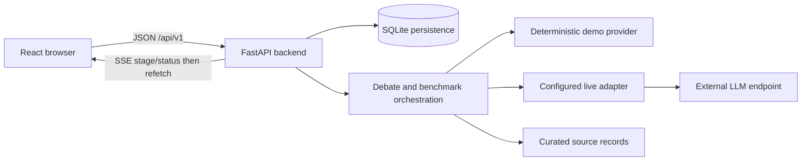
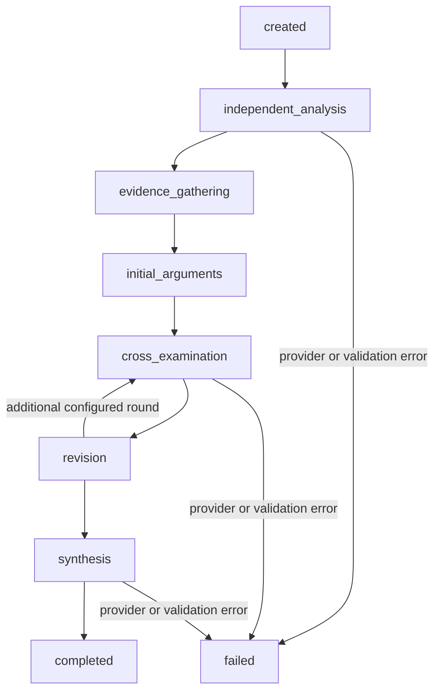
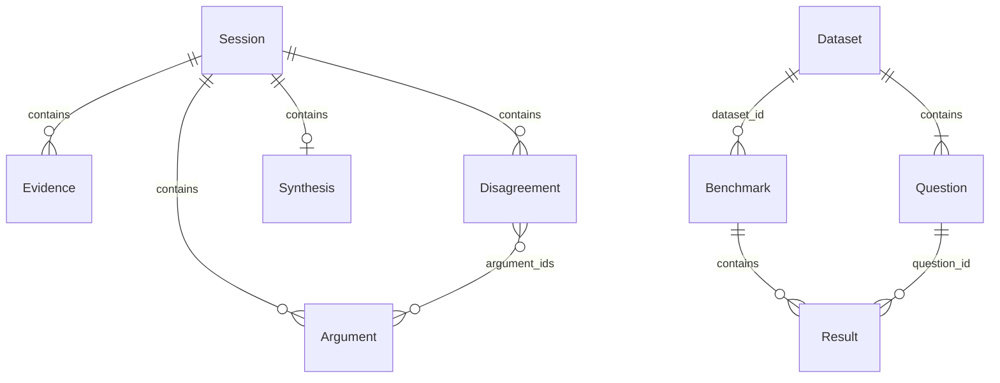
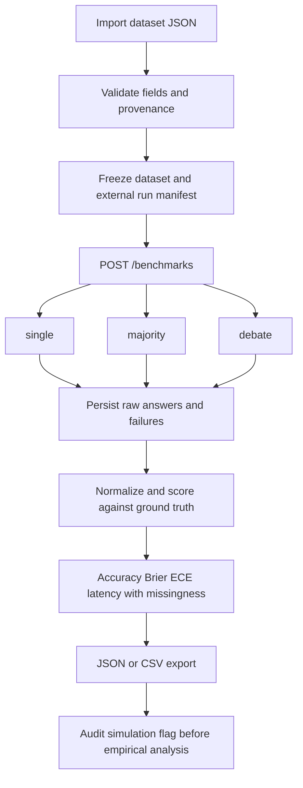
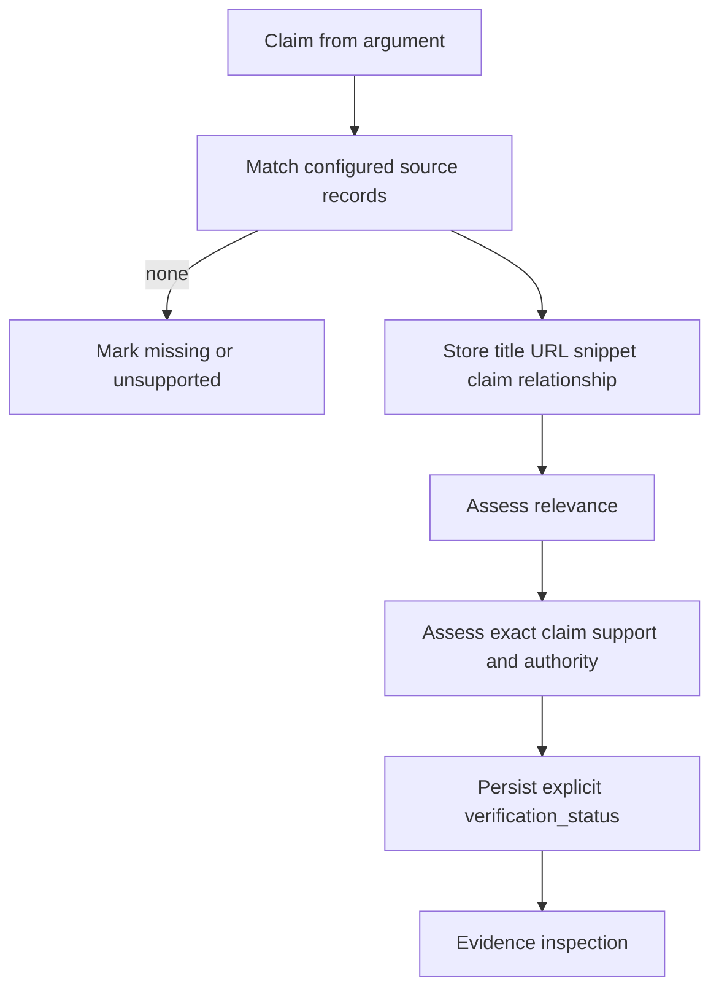

# Architecture diagrams

Contract-aligned design snapshot: `../IMPLEMENTATION.md`, 2026-10-19. These diagrams describe API concepts and intended execution, not a claim that all implementation paths have passed validation. Database entities below are logical JSON aggregates, not asserted physical SQL tables.

Credentials belong on the backend. Source text and model output are untrusted data.

Evidence gathering may have no records when disabled or unmatched. Preserve incomplete sessions on failure.

The evidence diagram includes a required assessment boundary. A curated match alone must not be represented as having passed support verification; human/automated entailment evaluation may remain future work.
